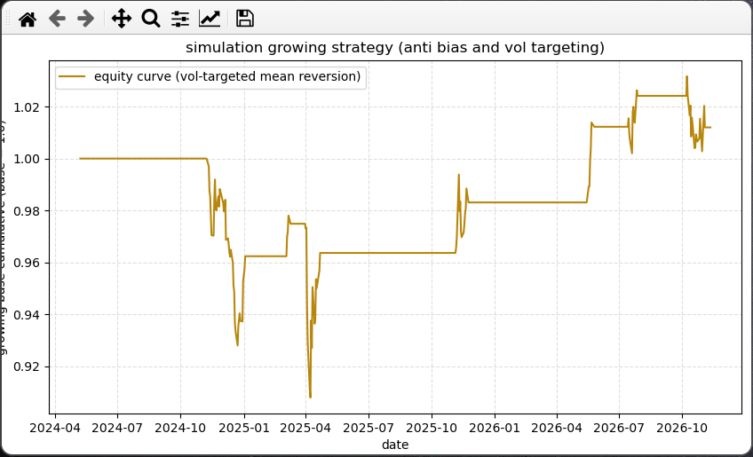

End-to-End System Architecture

```
[ 1. Raw OHLCV Ingestion ]
            │
            ▼ (Enforce 1D Series via .iloc[:, 0])
[ 2. Log Returns: np.log(Close / Close.shift(1)) ]
            │
            ├─────────────────────────────────────────┐
            ▼                                         ▼
[ 3. Technical Signals: closed='left' ]     [ 4. Volatility-Targeting Engine ]
  - fair_value (rolling mean)                 - realized_vol (rolling std * √252)
  - hell_nah (rolling std)                    - raw_weight = target_vol / realized_vol
  - buy_trig & close_trig                     - bounded_weight = raw_weight.clip(min, max)
            │                                         │
            ▼                                         │
[ 5. Vectorized State Machine ]                       │
  - raw_signal = np.where(buy, 1, np.where(exit, 0, nan))
  - status_posisi = Series(raw_signal).ffill().fillna(0)
            │                                         │
            ▼                                         │
[ 6. Anti-Lookahead Lag: .shift(1) ]                  │
            │                                         │
            └────────────────────┬────────────────────┘
                                 ▼
         [ 7. Final Exposure: active_position * bounded_weight ]
                                 │
                                 ▼
         [ 8. Strategy Return: final_exposure * log_return ]
                                 │
                                 ▼
         [ 9. Equity Curve: np.exp(strategy_ret.cumsum()) ]
```

